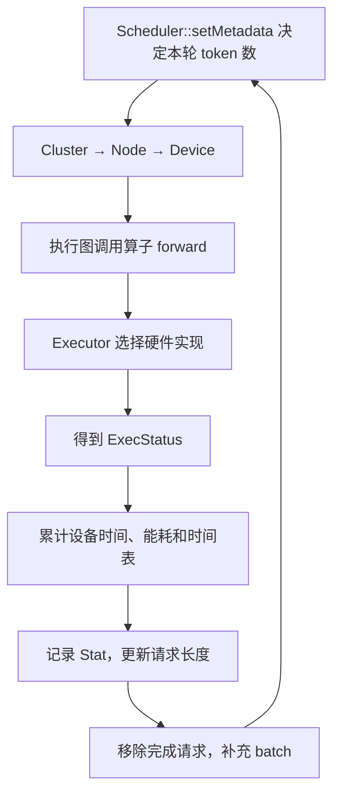

# LLMSimulator 代码架构与阅读指南

整理日期：2026-10-21。

本指南依据当前本地代码与前面的源码分析整理，用于学习 C++ 模型构建、请求调度、性能建模和 DRAM 接口。它不是上游官方设计规范，也不表示所有配置组合都经过运行验证。

相关资料：[上游 README](LLMSimulator/README.md)、[中文参数注释版](LLMSimulator/config.annotated.yaml)、[本地安装说明](SETUP.txt)。

## 1. 阅读目标与基本认识

建议同时推进两条主线：

1. **框架主线**：C++ 如何表达张量、组合模块、记录执行图，并驱动一次模拟执行。
2. **策略主线**：调度、并行、MLA、MoE 和内存策略具体改变哪些形状、状态与成本。

先沿一个 Linear 算子走通完整流程，再展开 MLA、MoE 和 Ramulator。

这个项目中的 `Tensor` 主要保存形状、字节数、设备和依赖状态；`forward()` 主要更新这些信息并提交性能估算请求。它没有加载完整模型权重并执行数值推理。因此，阅读时应分别记录：

- 模型在数学上应进行什么计算。
- 当前源码实际创建了什么对象、改变了什么形状。
- 哪部分耗时和能耗被建模，哪部分被省略。

## 2. 目录与职责

| 目录／文件 | 负责什么 | 阅读重点 |
|---|---|---|
| [eval/test.cpp](LLMSimulator/eval/test.cpp) | 主程序入口 | 配置、对象创建、启动与输出 |
| [src/model/](LLMSimulator/src/model/) | 模型结构和设备上的实例化 | 模型参数、层次组合 |
| [src/module/](LLMSimulator/src/module/) | 模块、张量、执行图和并行包装 | 形状变化、模块连接、依赖 |
| [src/scheduler/](LLMSimulator/src/scheduler/) | 请求与 batch 状态 | prefill/decode、token 推进、expert 负载 |
| [src/hardware/](LLMSimulator/src/hardware/) | 设备层级和性能模型 | GPU/LOGIC/PIM 分派、耗时公式 |
| [src/dram/](LLMSimulator/src/dram/) | 内存对象、地址映射、请求转换 | 张量如何变成 DRAM 请求 |
| [src/dram/ramulator2/](LLMSimulator/src/dram/ramulator2/) | DRAM 后端 | 控制器、命令调度、HBM 时序 |
| [patch/ramulator2_pim.patch](LLMSimulator/patch/ramulator2_pim.patch) | 定制 Ramulator 的修改 | 项目增加或改变的机制 |

尤其要区分 `module/` 与 `hardware/`：

```text
module/linear.cpp
    决定输入输出形状、权重形状、候选执行单元
            ↓
hardware/linear_impl.cpp
    根据这些信息计算 FLOPs、访存量、耗时等
```

## 3. 从构建目标确认入口

先读 [build.sh](build.sh)，确认源码目录、构建目录、编译模式和生成器，再沿下面的文件阅读：

1. [顶层 CMakeLists.txt](LLMSimulator/CMakeLists.txt)
2. [src/CMakeLists.txt](LLMSimulator/src/CMakeLists.txt)
3. 各子目录的 `CMakeLists.txt`
4. [eval/CMakeLists.txt](LLMSimulator/eval/CMakeLists.txt)

主要构建关系：

```text
eval/test.cpp → run
                 └─ libllm_system.so
                      ├─ hardware：OBJECT
                      ├─ module：OBJECT
                      ├─ model：OBJECT
                      ├─ scheduler：OBJECT
                      └─ dram：STATIC，包含 Ramulator 等实现
```

| CMake 命令 | 阅读时的含义 |
|---|---|
| `add_subdirectory(...)` | 继续处理哪个目录的构建规则 |
| `add_executable(...)` | 创建什么可执行目标 |
| `add_library(...)` | 创建什么库目标 |
| `target_sources(...)` | 哪些源文件真正加入该目标 |
| `target_link_libraries(...)` | 目标依赖哪些库 |
| `configure_file(... COPYONLY)` | 将哪些运行配置复制到构建目录 |

当前 `run` 的入口是 `eval/test.cpp` 的 `main()`。其他目录中的 `test.cpp` 即使包含 `main()`，也不一定加入了当前构建。

`CMakeCache.txt` 用来核对当前编译器、路径和构建选项；`compile_commands.json` 用来核对每个编译单元的实际编译命令。

在外层 `LLM_Sim/` 目录可使用：

```bash
rg -n 'int main\s*\(' LLMSimulator/eval LLMSimulator/src \
  -g '*.cpp' -g '!**/ramulator2/**'

rg -n '/eval/test.cpp' LLMSimulator/build/compile_commands.json

.venv/bin/ninja -C LLMSimulator/build -t commands run | tail -n 5
```

最后一条只展示构建命令，不执行编译。

## 4. 第一遍：入口和对象关系

阅读 [eval/test.cpp](LLMSimulator/eval/test.cpp)。第一遍可以略读大量参数分支和输出文件名拼接，先提取骨架：

```cpp
Scheduler::Ptr scheduler = Scheduler::Create(...);
Cluster::Ptr cluster = Cluster::Create(system_config, scheduler);
Model model(model_config, cluster, scheduler);

cluster->checkMemorySize();
cluster->set_dependency();
cluster->runIteration(total_iter, file_name);
```

上面的代码为流程摘录，省略了部分参数和中间步骤。

| 对象 | 作用 |
|---|---|
| `ModelConfig` | hidden size、head 数、expert 数、MLA 参数等 |
| `SystemConfig` | 设备数量、算力、带宽、执行策略等 |
| `Scheduler` | 管理请求队列，提供每轮工作量 |
| `Cluster` | 管理设备、仿真循环和统计 |
| `Model` | 为设备构建模型结构和执行图 |

设备层级：

```text
Cluster
  ├─ Executor
  └─ Node
      └─ Device
          ├─ TopModuleGraph
          ├─ StatusBoard
          ├─ DRAMInterface
          └─ MMapController
```

**完成标准：能解释配置分别传给谁、谁创建谁、谁启动仿真。**

## 5. 第二遍：Tensor 和 Module

推荐顺序：

1. [tensor.h](LLMSimulator/src/module/tensor.h)
2. [tensor.cpp](LLMSimulator/src/module/tensor.cpp)
3. [module.h](LLMSimulator/src/module/module.h)
4. [module.cpp](LLMSimulator/src/module/module.cpp)

### 5.1 Tensor：形状、内存与执行状态

先追踪这些成员：

```cpp
shape                 // 张量形状
precision_byte        // 每个元素的字节数
tag                   // weight / act / cache
ready                 // 模拟执行中的就绪状态
memory_object         // 对应的模拟内存对象
```

`getSize()` 按各维度乘积再乘 `precision_byte` 得到字节数。

同时留意 `setPerformHigh()`、`setPerformLow()`：执行单元选择信息可以附着在 Tensor 上，随后传给下游算子。

### 5.2 Module：组合模型的基本单元

两张表最重要：

```cpp
std::map<std::string, Tensor::Ptr> tensor_list;
std::map<std::string, Module::Ptr> module_list;
```

前者保存本模块的权重、激活和缓存；后者保存子模块，由此形成 `LLM → Decoder → Attention → Linear` 的层次。

重点函数：

- `add_module()`：登记子模块，并建立设备侧索引。
- `get_activation()`：获取已有激活对象，更新形状及就绪状态。
- `get_cache()`：获取缓存对象。
- `set_tensor_module()`：建立 Tensor 到所属模块的关联。
- `operator()`：记录模块调用并转入具体 `forward()`。

`module_map_name` 是类似 `::LLM::decoder_0::attention` 的层级名称，用于跨模块查找和统计。

**完成标准：能解释一个 Tensor 除了形状，还承担了哪些执行状态与关联关系。**

## 6. 第三遍：用 Linear 学习模块构建

阅读 [linear.h](LLMSimulator/src/module/linear.h) 和 [linear.cpp](LLMSimulator/src/module/linear.cpp)。

把生命周期分成三个步骤：

```text
Create()
  ↓
构造函数：创建权重和输出对象
  ↓
forward()：推导形状，选择执行策略，提交请求
```

对于 Linear：

```text
构造时：
    权重 A = [input_size, output_size]

forward 时：
    输入 X = [M, K]
    权重 A = [K, N]
    检查 K 一致
    输出 Y = [M, N]
    调用 Device::execution(LINEAR, ...)
```

值得掌握的 C++ 写法：

| 写法 | 本项目中的用途 |
|---|---|
| `class Linear : public Module` | 用统一接口表示不同模块 |
| `forward(...) override` | 实现具体模块行为 |
| `using Ptr = std::shared_ptr<Linear>` | 简化指针类型 |
| `static Create(...)` | 集中完成构造及后续初始化 |
| 构造函数初始化列表 | 初始化基类和成员 |
| `LayerInfo` | 将执行策略、head 信息等传给硬件层 |

调用 `(*linear)(input, metadata)` 时，先进入 `Module::operator()`，再通过虚函数分派进入 `Linear::forward()`。

**完成标准：能够描述新增一个简单模块所需的成员、构造逻辑和执行接口。**

## 7. 第四遍：分清构图和正式执行

推荐阅读：

- [model/model.h](LLMSimulator/src/model/model.h)
- [module/module.cpp](LLMSimulator/src/module/module.cpp) 中的 `operator()`
- [module_graph.h](LLMSimulator/src/module/module_graph.h)
- [module_graph.cpp](LLMSimulator/src/module/module_graph.cpp)

### 7.1 初始化：通过一次形状遍历记录图

`Model` 为每个设备创建一个 `LLM`，然后用模拟输入遍历：

```text
Model::model_distribute()
  → Module::operator()
      → push_module_graph()：记录进入模块
      → forward()：传播形状、调用子模块
      → pop_module_graph()：记录退出模块
```

此时 `Device::perform_execution` 为 false，普通算子的硬件耗时计算被门控。形状传播和模块调用过程仍然发生，并被记录到图中。

### 7.2 正式执行：重放记录中的可执行节点

```text
TopModuleGraph::run()
  → 检查当前图节点及其依赖
  → 对 graph_execution=true 的模块调用 forward()
  → 更新执行状态和时间表
```

并不是每个父模块都会重新递归执行一遍。组合模块负责组织结构；重放主要执行标记为可执行的模块，并利用进入／退出记录生成层级时间表。

| 开关 | 控制什么 |
|---|---|
| `Module::graph_execution` | 图重放时是否调用该模块的 `forward()` |
| `Device::perform_execution` | 是否进行硬件性能估算 |

重点读 `check_ready()`、`sync_devices()`、`set_dependency()` 和 `restart_graph()`。当前图执行以记录的节点顺序、就绪状态和同步为基础，不应直接理解成任意 DAG 的全局最优调度器。

**完成标准：能解释 `forward()` 在初始化与正式运行中的作用，以及日志父子层级为什么不能重复求和。**

## 8. 第五遍：一次仿真迭代与状态回传

### 8.1 请求与 batch

阅读 [sequence.h](LLMSimulator/src/scheduler/sequence.h)、[sequence.cpp](LLMSimulator/src/scheduler/sequence.cpp)、[scheduler.cpp](LLMSimulator/src/scheduler/scheduler.cpp)。

```text
Sequence：一条请求
BatchedSequence：一个 DP 副本的 batch
Scheduler：等待队列和所有运行 batch 的管理者
```

先追踪一条请求的四个字段：

```cpp
input_len
current_len
total_len
num_process_token
```

再按顺序读：

1. `pushDummySeq()`：合成请求如何初始化，阶段开关如何影响初始长度。
2. `fillSequenceQueue()` / `fillRunningQueue()`：请求如何入队和填充 batch。
3. `setMetadata()`：本轮哪些请求处理多少 token。
4. `Sequence::update()`：长度怎样推进。
5. `updateScheduler()`：何时移除完成请求。
6. `hittingQueue()`：正式仿真前如何仅推进调度状态。

### 8.2 正式仿真循环

在 [cluster.cpp](LLMSimulator/src/hardware/cluster.cpp) 中先读 `runIterationMixed()`，再读 `runIterationSumGenSplit()`。



不支持 Mermaid 的阅读器可按以下文本理解：

```text
组织本轮 batch → 执行 → 统计 → 推进请求 → 补入请求 → 下一轮
```

### 8.3 一个算子的硬件调用链

```text
Linear::forward()
  → Device::execution()
    → Executor::execution()
      → executePType()
        → executeLinear()
          → LinearExecutionGPU / Logic / PIM
```

查看 [executor.cpp](LLMSimulator/src/hardware/executor.cpp) 的 `initLinear()`，理解枚举如何索引具体实现函数。

### 8.4 从性能结果到日志

```text
ExecStatus
  → Device 保存本次结果
  → TopModuleGraph::set_pop_status()
  → StatusBoard 累计状态
  → TimeStamp / Stat
  → test.log / CSV
```

关键文件：[status.h](LLMSimulator/src/module/status.h)、[timeboard.cpp](LLMSimulator/src/module/timeboard.cpp)、[hardware/stat.h](LLMSimulator/src/hardware/stat.h)。

注意 `ExecStatus::operator+=` 只合并部分字段，并不是将整个结构体所有指标逐项相加。需要继续看调用者如何设置 `total_duration`。

**完成标准：能从一条请求的 token 数，追踪到一个 Linear 的形状、耗时和日志。**

## 9. 第六遍：展开模型与策略

代码中的 `sum` 通常表示 prefill／summarization，`gen` 表示 decode／generation。

| 顺序 | 阅读主题 | 主要文件 | 需要记录的内容 |
|---|---|---|---|
| 1 | 模型层次 | [llm.cpp](LLMSimulator/src/model/llm.cpp)、[decoder.cpp](LLMSimulator/src/module/decoder.cpp) | dense/MoE 层组合与输入输出连接 |
| 2 | 普通 Attention | [layer.cpp](LLMSimulator/src/module/layer.cpp)、[attention.cpp](LLMSimulator/src/module/attention.cpp) | QKV、输出投影、prefill/decode 分支 |
| 3 | 张量并行 | [parallel.cpp](LLMSimulator/src/module/parallel.cpp) | Column/Row Parallel 切分哪一维，通信在哪里 |
| 4 | MLA | `layer.cpp`、[compressed_kv_restore.cpp](LLMSimulator/src/module/compressed_kv_restore.cpp)、`attention.cpp` | cache 表示、KV 恢复、absorb 计算图 |
| 5 | MoE | [expert.cpp](LLMSimulator/src/module/expert.cpp)、[route.cpp](LLMSimulator/src/module/route.cpp)、`scheduler/sequence.cpp` | 路由负载、专家分布、执行单元分配 |
| 6 | 通信 | [communication.cpp](LLMSimulator/src/module/communication.cpp) | 通信量、同步依赖、延迟公式 |
| 7 | 性能公式 | [linear_impl.cpp](LLMSimulator/src/hardware/linear_impl.cpp)、[attention_gen_impl.cpp](LLMSimulator/src/hardware/attention_gen_impl.cpp)、[attention_sum_impl.cpp](LLMSimulator/src/hardware/attention_sum_impl.cpp)、[attention_mixed_impl.cpp](LLMSimulator/src/hardware/attention_mixed_impl.cpp)、[activation_impl.cpp](LLMSimulator/src/hardware/activation_impl.cpp) | FLOPs、字节数、融合与分块假设 |

### 9.1 用 compressed_kv_restore 做一次策略追踪

该模块位于 `use_absorb=off` 的 MLA 分支。当前默认 `use_absorb=on` 时，不走这条构图路径。

当 `compressed_kv=on` 时，其输出形状包含：

```cpp
latent_kv_shape = {
    sum_token + gen_total_token + num_gen_sequences,
    kv_lora_rank
};
```

在本轮仅有一条 decode 请求、已有长度为 L 的情况下，第一维为 L+1。后续 KV up-projection 按这一长度建模。

```text
compressed_kv 开关
  → latent 张量长度变化
  → 下游 KV up-projection 的 M 维变化
  → FLOPs、访存量、临时激活变化
```

该文件没有实际解压数值；相关恢复成本主要通过下游模块的形状体现。

### 9.2 对每个优化开关使用同一套记录方法

```text
YAML 字段
  → 配置成员
  → 哪个 if 分支
  → 图结构／形状／调度怎样变化
  → 哪项成本发生变化
  → 哪些配置下不生效
```

还要区分三个概念：请求调度由 `Scheduler` 管理；expert 分配策略主要在 `Route` 等模块中；候选执行单元的耗时比较在 `Executor` 中。它们并不是同一个调度器。

**完成标准：能根据源码解释一个开关为什么改变结果，而不是只根据开关名字猜测。**

## 10. 第七遍：DRAM 适配层与 Ramulator

### 10.1 先读项目自己的内存模型

```text
Tensor
  → MemoryObject：地址、大小、访问块数
    → MMapController：映射到 channel / bank / row / column
```

阅读 [memory_object.cpp](LLMSimulator/src/dram/memory_object.cpp)、[mmap_controller.cpp](LLMSimulator/src/dram/mmap_controller.cpp)、[memory_config.h](LLMSimulator/src/dram/memory_config.h)。

再追踪请求链：

```text
issueRamulator()
  → DRAMRequest
    → DRAMInterface
      → pimkernel 的 Read / Write / GEMV
        → PIMRequest
          → Ramulator frontend / memory system
```

入口：[layer_impl.cpp](LLMSimulator/src/hardware/layer_impl.cpp)、[dram_interface.cpp](LLMSimulator/src/dram/dram_interface.cpp)、[pimkernel/](LLMSimulator/src/dram/pimkernel/)。

### 10.2 根据 YAML 选择后端实现

以 [dram_config_HBM3E_192GB.yaml](LLMSimulator/dram_config_HBM3E_192GB.yaml) 为例：

```text
PIMController
  → PIMDRAMSystem
    → PIM_DRAM_controller
      → PIM_Scheduler
      → HBM3
```

对应文件：

- [frontend/impl/PIM_controller.cpp](LLMSimulator/src/dram/ramulator2/src/frontend/impl/PIM_controller.cpp)
- [memory_system/impl/PIM_DRAM_system.cpp](LLMSimulator/src/dram/ramulator2/src/memory_system/impl/PIM_DRAM_system.cpp)
- [dram_controller/impl/PIM_dram_controller.cpp](LLMSimulator/src/dram/ramulator2/src/dram_controller/impl/PIM_dram_controller.cpp)
- [dram_controller/impl/scheduler/PIM_scheduler.cpp](LLMSimulator/src/dram/ramulator2/src/dram_controller/impl/scheduler/PIM_scheduler.cpp)
- [dram/impl/HBM3.cpp](LLMSimulator/src/dram/ramulator2/src/dram/impl/HBM3.cpp)

研究 row conflict 时，依次追踪：地址映射、bank 当前打开的 row、ACT/PRE/RD/WR 选择、时序约束、请求重排，以及执行结果缓存是否跳过了本次访存模拟。

当前 GPU Linear 的权重读取主要按固定访问粒度生成连续地址，不是根据真实 GEMM tile 遍历生成 trace。Ramulator 细化的是这套合成请求的执行过程。不要把 DRAM 后端精细等同于前端访问序列真实。

`issueRamulator()` 的结果缓存键只包含算子类型、处理器类型、请求类型、张量大小；研究地址顺序和 row-buffer 状态时，需要检查这种复用是否适用。

**完成标准：能从一个权重 Tensor 追到 DRAM 请求，并说明生成过程保留和省略了哪些信息。**

## 11. C++ 设计学习与实现审查

| 机制 | 例子 | 阅读时的检查点 |
|---|---|---|
| 继承、虚函数 | `Module` 与算子子类 | 实际调用哪个 `forward()` |
| 组合 | 模块持有子模块 | 构造函数和 forward 的连接是否一致 |
| 工厂方法 | `Create()` | 构造之后还有哪些初始化 |
| 智能指针 | `shared_ptr`、`shared_from_this()` | 对象所有权和生命周期 |
| 模板 | `add_module<T>()` | 子类如何统一存入 `Module::Ptr` |
| 函数指针分派 | `Executor::initLinear()` | 枚举和具体实现如何对应 |
| 引用与复制 | Scheduler 持有 `ModelConfig&`，Device 持有配置副本 | 修改配置时哪些对象会看到变化 |
| 运算符重载 | `operator()`、`operator+=` | 不要根据符号假设全部语义 |
| 前置声明、friend | ModuleGraph、Device 等 | 类型依赖与内部访问关系 |

两个值得单独记笔记的例子：

1. 模块持有 Tensor，Tensor 又通过 `shared_ptr` 指回模块，应检查双向强引用形成的循环。自己设计框架时，应明确拥有关系与观察关系，后者通常可以考虑 `weak_ptr`。
2. 当前 `LLM::forward()` 的层循环反复将 `temp` 传给 decoder，没有每轮执行 `temp = out`。不能直接把这段代码照搬成数值推理网络；要分别核对它的形状、显式执行顺序和数学数据依赖。

这份研究代码适合学习架构与建模，也适合练习代码审查。遇到异常时，不要默认实现就是策略定义。

## 12. 阅读时必须保留的实现限制清单

- `Embedding` 和 `LmHead` 当前主要更新形状，没有计入对应硬件执行耗时。
- `output_len` 是请求输出长度，`iter` 是正式仿真循环次数；当前长度约定为 `input_len + output_len - 1`。
- 正式仿真前调用 `hittingQueue(10000)`，会仅推进调度状态，因此计时不一定从新请求的起点开始。
- 普通循环在下一轮开始时写出上一轮统计，结束后没有补写末轮；分离模式也存在尾部未写出的情况。
- 每轮时间表被重置，默认控制台详细时间表展示最后一轮的设备 0。
- 日志行中的能耗 `Total` 当前未包含 `MAC`；CSV 的总能耗计算包含它。
- GPU Linear 主要采用整体 FLOPs 和访存量估算，没有真实 GPU GEMM tiling、缓存与线程调度模型。
- `use_ramulator=on` 不会自动补齐真实 GPU 的访存生成行为。
- `injection_rate` 字段当前没有被主程序读取。
- `use_absorb=on` 的路径始终创建 latent cache，不能只将 `compressed_kv` 设为 off 就视为关闭压缩。

以上是已观察到的实现行为，不是完整缺陷清单；本次整理没有修改这些逻辑。

## 13. 建议的阅读记录与练习

### 13.1 每个模块的记录模板

```text
模块名：
所属构建目标：
由谁创建、由谁调用：
持有哪些权重、激活、缓存：
输入输出形状：
影响行为的配置：
修改哪些状态：
时间/能耗从哪里得到：
有哪些简化或尚未确认的问题：
```

### 13.2 学习检查表

- [ ] 找到 run 的入口和实际编译源文件。
- [ ] 画出 Cluster、Node、Device 和 Model 的对象关系。
- [ ] 解释 Tensor 的形状、大小、ready 状态和内存对象。
- [ ] 完整追踪一个 Linear 的构造、forward 与硬件调用。
- [ ] 区分构图过程和正式图重放。
- [ ] 追踪一条请求从入队到完成的状态变化。
- [ ] 从 ExecStatus 追到日志和 CSV。
- [ ] 解释一次 TP 切分及其通信位置。
- [ ] 对照三种 MLA 策略，列出 cache 和计算图的变化。
- [ ] 追踪一个 token 的 expert 路由与执行单元分配。
- [ ] 追踪一次权重读取到 DRAM 地址和命令。
- [ ] 分开记录设计意图、实际实现、实验验证和未确认问题。

### 13.3 四个贯穿全项目的练习

1. **普通 Linear**：从 `[M,K] × [K,N]` 追到耗时，再追到日志。
2. **一个 decode 请求**：从加入队列追到长度推进、完成和补入新请求。
3. **一个 MLA 开关**：从 YAML 追到图结构、cache 形状和成本变化。
4. **一次权重读取**：从 Tensor 追到地址序列和 DRAM 命令，明确哪些行为被省略。

开始时保留当前默认配置作为对照。做策略实验时，把配置、日志和 CSV 保存到独立实验目录：上游文件名没有包含所有优化开关，不同实验可能覆盖同名文件。

注意运行入口差异：外层 `run.sh` 默认读取 `LLMSimulator/config.yaml`；在 `LLMSimulator/build/` 中直接执行 `./run`，默认读取 `build/config.yaml`。源码配置和构建目录副本不要混淆。

`export_gantt` 开启后，当前实现会清空 `gantt_directory` 的原有内容，再写设备时间表；该目录应专用于生成结果。
